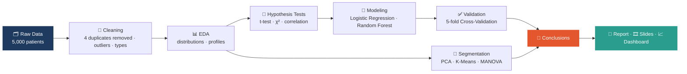

<div align="center">

# 🏥 Hospital Readmission Analysis

### Can patient and hospitalization data predict who comes back?

**An end-to-end data analysis project: hypothesis testing, machine learning, patient clustering, and an honest conclusion.**


[Overview](#-overview) •
[Key Findings](#-key-findings) •
[Workflow](#-workflow) •
[Dataset](#%EF%B8%8F-dataset) •
[Results](#-results-in-detail) •
[Repository](#-repository-structure) •
[Run It](#%EF%B8%8F-how-to-run)

</div>

---

## 🎯 Overview

Hospital readmissions are costly for patients and health systems alike. This project asks one focused question:

> **Can a patient's demographics and hospitalization details predict whether they will be readmitted?**

To answer it, the project runs the full analytics pipeline: data cleaning, exploratory analysis, statistical hypothesis tests, **logistic regression**, **Random Forest** with **cross-validation**, and **K-Means patient segmentation**. The results are packaged as a notebook, a written report, a presentation, and an interactive Power BI dashboard.

<div align="center">

| 👥 Patients | 📋 Features | 🔁 Readmission Rate | 🧪 Best Held-out AUC | ⚖️ Chance Level |
|:---:|:---:|:---:|:---:|:---:|
| **5,000** | **8** | **18.81%** | **≈ 0.47** | **0.50** |

</div>

---

## 💡 Key Findings

> [!IMPORTANT]
> **The hypothesis was not supported.** None of the measured variables carry real predictive signal for readmission, and this project shows *how rigorously* that conclusion was reached.

| | Finding | Evidence |
|:---:|---|---|
| ❌ | **No statistical associations** | Age, gender, diagnosis, discharge destination, length of stay, procedures, and comorbidity score are all non-significant (all p > 0.28) |
| ❌ | **No multivariate signal** | Logistic regression is not significant overall (LLR p = 0.905); every odds ratio is near 1 and every 95% CI includes 1 |
| ❌ | **No natural patient groups** | Silhouette scores stay below 0.23 for every k; readmission rates are nearly identical across clusters (18.0% – 19.9%) |
| ⚠️ | **A cautionary tale on overfitting** | Random Forest scored **0.711 AUC on full data** but only **0.469 under 5-fold cross-validation** |
| 🧭 | **Practical takeaway** | The drivers of readmission likely lie *outside* this dataset: post-discharge follow-up, medication adherence, social factors |

---

## 🔄 Workflow



---

## 🗃️ Dataset

Each row is one hospital stay. The target is `readmitted`.

> 🧹 **Data cleaning:** the original file has **5,000** records. During cleaning, **4 duplicate observations were removed**, leaving **4,996** unique records. The clusters file is built on this cleaned version.

| Column | Type | Description |
|---|:---:|---|
| `age` | numeric | Patient age (18 – 89) |
| `gender` | categorical | Male / Female |
| `primary_diagnosis` | categorical | COPD · Diabetes · Heart Disease · Hypertension · Kidney Disease |
| `num_procedures` | numeric | Number of procedures during the stay |
| `days_in_hospital` | numeric | Length of stay in days |
| `comorbidity_score` | numeric | Comorbidity burden score |
| `discharge_to` | categorical | Home · Home Health Care · Rehabilitation Facility · Skilled Nursing Facility |
| `readmitted` | binary | 🎯 **Target:** `1` = readmitted, `0` = not readmitted |
| `Cluster` | categorical | K-Means label *(only in the clusters file)* |

<details>
<summary><b>📈 Population snapshot</b> (click to expand)</summary>

<br/>

| Metric | Value |
|---|---|
| Mean age / median age | 53.29 / 53 |
| Gender split | 49.6% male · 50.4% female |
| Mean hospital stay | 7.40 days |
| Mean procedures | 4.46 |
| Mean comorbidity score | 2.07 |
| Most common diagnosis | Kidney Disease |
| Age distribution | Symmetric (skewness ≈ 0.01), no outliers |

</details>

---

## 🔬 Results in Detail

### 1️⃣ Statistical tests: is anything associated with readmission?

Independent t-tests (numeric variables) and chi-square tests (categorical variables) were run after checking normality (Shapiro-Wilk) and equal variance (Levene). Each bar below shows the p-value on a 0 – 1 scale.

| Variable | Test | Statistic | p-value | | Verdict |
|---|:---:|:---:|:---:|---|:---:|
| Gender | χ² | 1.138 | 0.286 | `███░░░░░░░` | Not significant |
| Days in hospital | t-test | 0.707 | 0.480 | `█████░░░░░` | Not significant |
| Discharge destination | χ² | 2.204 | 0.531 | `█████░░░░░` | Not significant |
| Primary diagnosis | χ² | 2.016 | 0.733 | `███████░░░` | Not significant |
| Number of procedures | t-test | 0.213 | 0.831 | `████████░░` | Not significant |
| Age | t-test | -0.114 | 0.909 | `█████████░` | Not significant |
| Comorbidity score | t-test | 0.095 | 0.925 | `█████████░` | Not significant |

> To be significant (p < 0.05), a variable would need a bar shorter than **half a block**. None comes close.

**Readmission rate by primary diagnosis** is nearly flat (overall rate: 18.81%):

| Diagnosis | Readmitted / Total | Rate | |
|---|:---:|:---:|---|
| Kidney Disease | 206 / 1,035 | 19.9% | `████████████████████` |
| Diabetes | 198 / 1,016 | 19.5% | `███████████████████░` |
| COPD | 187 / 1,009 | 18.5% | `██████████████████░░` |
| Heart Disease | 175 / 958 | 18.3% | `██████████████████░░` |
| Hypertension | 174 / 978 | 17.8% | `█████████████████░░░` |

The correlation matrix among the four numeric variables also shows no meaningful relationships (|r| ≤ 0.025).

---

### 2️⃣ Predictive modeling: can a model do better?

<details>
<summary><b>🧮 Logistic regression: odds ratios</b> (click to expand)</summary>

<br/>

| Variable | OR | 95% CI | p-value |
|---|:---:|:---:|:---:|
| Age | 1.000 | 0.997 – 1.004 | 0.890 |
| Number of procedures | 0.997 | 0.972 – 1.021 | 0.787 |
| Days in hospital | 0.993 | 0.976 – 1.011 | 0.447 |
| Comorbidity score | 0.997 | 0.948 – 1.048 | 0.906 |
| Gender | 0.922 | 0.800 – 1.063 | 0.264 |
| Skilled Nursing Facility | 0.873 | 0.711 – 1.071 | 0.192 |
| Kidney Disease | 1.093 | 0.877 – 1.363 | 0.428 |

All VIF values are below 2, so there is no multicollinearity problem. The model simply has nothing to find.

</details>

The logistic model reached **81.2% accuracy**, but only because it predicted *"not readmitted"* for everyone: **precision, recall, and F1 are all 0** (ROC-AUC 0.528). This is a classic imbalanced-class trap where accuracy hides total failure.

Random Forest then looked promising, until it was validated properly:

| Model | Evaluation | ROC-AUC | | vs. chance (0.50) |
|---|---|:---:|---|:---:|
| Logistic Regression | Full data | 0.528 | `█████░░░░░` | slightly above |
| Logistic Regression | 5-fold CV | 0.467 | `████░░░░░░` | below |
| Random Forest | Full data | **0.711** | `███████░░░` | looks strong 🚩 |
| Random Forest | 5-fold CV | **0.469** | `████░░░░░░` | below |

> [!WARNING]
> A high score on training data is not evidence of a good model. Cross-validation exposed the Random Forest's 0.711 as memorized noise. **Always validate before trusting a score.**

**Random Forest feature importance** (importance describes how the model *used* a variable, not whether it truly matters):

| Rank | Feature | Importance | |
|:---:|---|:---:|---|
| 1 | Age | 0.294 | `██████████████████████████████` |
| 2 | Days in hospital | 0.184 | `██████████████████░░░░░░░░░░░░` |
| 3 | Number of procedures | 0.161 | `████████████████░░░░░░░░░░░░░░` |
| 4 | Comorbidity score | 0.101 | `██████████░░░░░░░░░░░░░░░░░░░░` |
| 5 | Gender | 0.041 | `████░░░░░░░░░░░░░░░░░░░░░░░░░░` |

Age ranks first here, yet logistic regression found its effect to be zero (p = 0.89). That contradiction is itself a sign the ranking reflects noise.

---

### 3️⃣ Patient segmentation: do natural groups exist?

**Pipeline:** Standardization → PCA → K-Means (k = 2 – 8) → Elbow + Silhouette → MANOVA / ANOVA

- The elbow curve has no distinct elbow, and silhouette scores stay under **0.23** for every k.
- A 4-cluster solution (silhouette 0.19) was fitted for illustration. In PCA space it forms **one continuous cloud**, not separate groups.
- The clusters differ sharply on the variables used to build them (MANOVA Wilks' Λ = 0.095, p < 0.001), which is expected since K-Means optimizes exactly that.
- **But readmission does not differ across clusters:**

| Cluster | Readmission rate | |
|---|:---:|---|
| Cluster 0 | 19.9% | `████████████████████` |
| Cluster 1 | 18.6% | `██████████████████░░` |
| Cluster 2 | 18.0% | `██████████████████░░` |
| Cluster 3 | 18.8% | `██████████████████░░` |

χ²(3) = 1.591, **p = 0.661**, so there is no significant difference.

---

## 🧠 What This Project Demonstrates

| Skill | Where it shows |
|---|---|
| **Data cleaning & EDA** | Duplicate removal, IQR outlier checks, distribution analysis |
| **Statistical rigor** | Assumption checks (Shapiro, Levene) before choosing each test |
| **Machine learning** | Logistic Regression, Random Forest, class-imbalance awareness |
| **Model validation** | Stratified 5-fold CV to catch overfitting |
| **Unsupervised learning** | PCA, K-Means, elbow and silhouette diagnostics |
| **Communication** | Notebook → report → slides → interactive dashboard |
| **Intellectual honesty** | Reporting a null result clearly instead of forcing a story |

---

## 📁 Repository Structure

```text
📦 hospital-readmission-analysis
 ┣ 📓 hospital_readmission_analysis_ipynb.ipynb   # Full analysis notebook
 ┣ 📑 hospital_readmission_report_docx.docx       # Detailed written report (18 questions)
 ┣ 🎞️ hospital_readmission_presentation_pptx.pptx # 27-slide presentation
 ┣ 📈 hospital_readmission_dashboard_pbix.pbix    # Power BI dashboard
 ┣ 🗂️ hospital_readmission_data_xlsx.xlsx         # Original dataset (sheet: train_df)
 ┣ 🧩 hospital_data_with_clusters_xlsx.xlsx       # Dataset + K-Means cluster labels
 ┗ 📝 README.md
```

| Deliverable | Best for |
|---|---|
| 📓 **Notebook** | Reproducing every number, test, and plot |
| 📑 **Report** | Reading the full statistical story, question by question |
| 🎞️ **Presentation** | A 5-minute overview of the project |
| 📈 **Dashboard** | Exploring the data interactively (open with Power BI Desktop) |

---

## ⚙️ How to Run

```bash
# 1. Clone the repository
git clone <your-repo-url>
cd <your-repo-folder>

# 2. Install dependencies
pip install pandas numpy matplotlib seaborn scipy statsmodels scikit-learn jupyter openpyxl

# 3. Export the `train_df` sheet of hospital_readmission_data_xlsx.xlsx
#    to train_df.csv, in the same folder as the notebook

# 4. Launch the notebook
jupyter notebook hospital_readmission_analysis_ipynb.ipynb
```

> [!NOTE]
> The notebook reads `train_df.csv`. If you prefer to use the Excel file directly, replace the first read line with:
> `df = pd.read_excel("hospital_readmission_data_xlsx.xlsx")`

---

## 🚀 Possible Next Steps

- Add post-discharge variables (follow-up visits, medication adherence, social support) to the dataset.
- Handle class imbalance (class weights, SMOTE) and optimize recall rather than accuracy.
- Try gradient boosting with proper hyperparameter tuning and nested cross-validation.
- Replicate the study on a larger, multi-hospital dataset.

---

## 👩‍💻 Author

<div align="center">

**Hadeer Hussen Atia**
Statistics graduate · Cairo University, Faculty of Economics & Political Science
Data Analysis · Econometrics · Python · SQL · R · Power BI

⭐ *If you found this project useful, consider giving it a star!* ⭐

</div>
